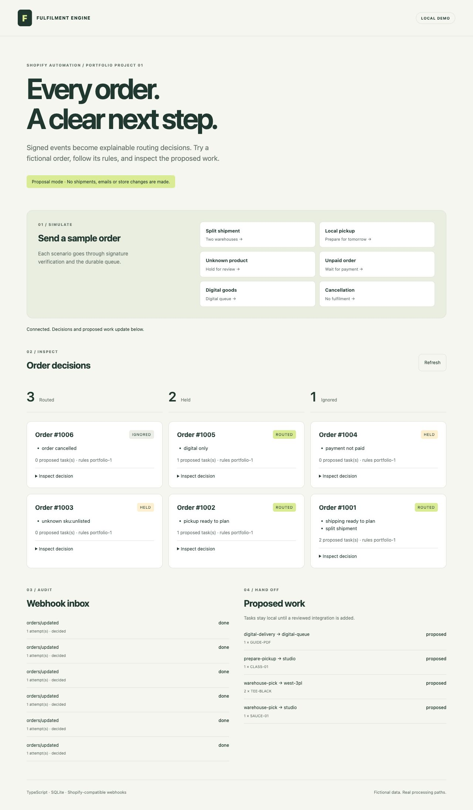
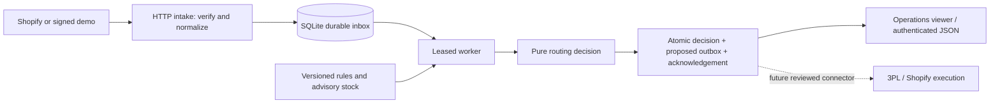

# Shopify Fulfilment & Automation Engine

[](https://github.com/nnacrp0815/shopify-fulfilment-engine/actions/workflows/ci.yml)

An explainable order-routing service for Shopify workflows. Verify an order webhook, persist it before acknowledging, evaluate business rules, and turn the decision into reviewable fulfilment tasks.

**Production-oriented portfolio MVP.** The intake, queue, rules and local outbox work end to end. The outbox contains **proposals**: this version does not send shipments, reserve inventory, deliver digital products, email customers or mutate a Shopify store. All examples use fictional data and original project code.

## Try it in two minutes

Requires **Node.js 24.14+ within the 24.x release line** and npm. Node's built-in SQLite may print an experimental-feature warning on earlier 24.x releases.

```sh
git clone https://github.com/nnacrp0815/shopify-fulfilment-engine.git
cd shopify-fulfilment-engine
npm ci
npm run demo
```

No Shopify account, token, tunnel or `.env` is required. The demo starts an ephemeral local HTTP server, sends six HMAC-signed fictional webhooks, redelivers one, drains a temporary SQLite queue and asserts the result:

```text
3 routed / 2 held / 1 ignored
4 proposed tasks
duplicate suppressed
```

For the interactive operations viewer:

```sh
npm start
```

Open [localhost:3000](http://127.0.0.1:3000). Click **Split shipment**, **Local pickup**, **Unknown product**, **Unpaid order**, **Digital goods**, or **Cancellation**. Inspect reasons, webhook attempts and proposed work. Demo mode binds only to the loopback interface. The viewer retains its fictional history in `data/engine.sqlite`; the command-line demo uses and removes a separate temporary database.

<details>
<summary>Preview the verified operations demo</summary>



</details>

## What it demonstrates

| Capability       | Behaviour                                                                                                                                                               |
| ---------------- | ----------------------------------------------------------------------------------------------------------------------------------------------------------------------- |
| Order validation | Safe identifiers, exact decimal-to-cent amounts, remaining quantities, SKU allowlist, currency, subtotal, unit limit, country, shipping flags, pickup date and location |
| Routing          | Prefer one eligible warehouse; otherwise split by configured priority and available advisory stock; accumulate quantities across repeated SKU lines                     |
| Mixed carts      | Separate digital and physical tasks; pickup-only products cannot ship; any hold prevents all partial tasks                                                              |
| Webhooks         | Verify raw bytes with HMAC-SHA256 and constant-time comparison; support secret rotation; enforce shop, topic, metadata, JSON and 1 MiB limits                           |
| Reliability      | Durable SQLite inbox, delivery deduplication, payload-collision rejection, leases, fencing, bounded retries, dead letters and explicit replay                           |
| Ordering         | Ignore older snapshots; suppress unchanged orders; hold equal-timestamp conflicts; supersede earlier proposals when a new decision replaces them                        |
| Auditability     | Explainable reason codes, rules version/hash, delivery outcomes and stable task identifiers                                                                             |
| Shopify adapter  | Versioned read-only GraphQL client, bounded transient retries, explicit pagination guard, validated move-proposal builder                                               |
| Operations       | Local viewer, authenticated service API, health endpoint, graceful shutdown and a recovery runbook                                                                      |

## Architecture



The HTTP response is sent after the inbox transaction commits, before routing runs. There is no upstream API call on the webhook path. A failed database write returns `503`, allowing Shopify to retry. Rule validation is synchronous and bounded by the payload and line limits. See [architecture and decisions](docs/architecture.md).

## Configure the rules

Copy [`.env.example`](.env.example) to `.env` if you want to override defaults. Edit [`config/rules.example.json`](config/rules.example.json), or point `RULES_PATH` at a private file. Configuration is validated on startup; restart after a change.

- `minimumSubtotalCents` applies to **current subtotal after discounts**, excluding shipping and tax; it applies to all delivery types, including digital orders.
- Only `financial_status: "paid"` can route. Partially paid, refunded and pending orders hold.
- `fulfillable_quantity` determines work remaining; original purchased quantity is not used for allocation.
- `warehouses[].stock` is a **static advisory snapshot**, not live stock. It is shared across lines within one order only. Different orders do not reserve or decrement it.
- `allowSplitShipping: false` requires one warehouse to cover the complete physical cart. Pickup always requires its nominated location to cover the cart.
- Equal warehouse priorities break ties by location ID.
- `catalog.kind` is `shippable`, `pickup-only` or `digital`. Digital items must have `requires_shipping: false`; physical items must have it `true`.
- Pickup dates use the configured timezone and accept today or later. There is no capacity calendar or cutoff schedule in this MVP.

Pickup uses an explicit **merchant integration contract**, not inferred Shopify-native pickup metadata:

```json
{
  "note_attributes": [
    { "name": "delivery_method", "value": "pickup" },
    { "name": "pickup_date", "value": "2026-12-01" },
    { "name": "pickup_location", "value": "studio" }
  ]
}
```

The default method is `shipping`. Unknown methods, duplicate recognized attributes, missing SKUs and incompatible carts fail closed. Adapt the normalizer to your pickup app's verified payload before connecting a real store.

## Service mode and Shopify compatibility

Service mode receives signed events for **one configured shop**. It is a backend integration component, not an installable embedded app or Shopify Function. It does not implement OAuth, billing, App Store compliance webhooks or a merchant onboarding UI.

1. Create your own development app using Shopify's official tooling and libraries. Obtain its client secret through your own secure setup; never commit credentials.
2. Configure `MODE=service`, `SHOPIFY_SHOP`, `SHOPIFY_WEBHOOK_SECRET` and a random `ADMIN_TOKEN` of at least 32 characters. See [`.env.example`](.env.example). Bind to your deployment interface with `HOST`.
3. Put the service behind HTTPS with a valid certificate, upstream request limits/timeouts and restricted admin access. Persist its local SQLite volume. Run `npm ci && npm run build`, then `node --env-file-if-exists=.env dist/src/main.js`.
4. Subscribe the app to `orders/create`, `orders/paid`, `orders/updated` and `orders/cancelled`, with HTTPS destination `/webhooks/orders` and API version `2026-10`. Ensure payloads contain the normalizer's required fields. Secure the appropriate order/protected-data access through your app setup.
5. Verify signatures and sample payloads on the development store before using operational data. Production workloads, event gaps and lost subscriptions require reconciliation outside this MVP.

The service API uses `Authorization: Bearer <ADMIN_TOKEN>` for `GET /api/state`. The viewer can accept that token in a password field; it stays in page memory and is never written to browser storage or a URL. `GET /healthz` only checks database access. Demo scenario endpoints are unavailable in service mode.

Shopify [documents raw-body HMAC verification and delivery deduplication](https://shopify.dev/docs/apps/build/webhooks/verify-deliveries). Delivery IDs are scoped by shop and topic. Event IDs are stored for correlation; order snapshot identity independently prevents duplicate proposals from different subscriptions. Request metadata headers are not included in Shopify's body HMAC: this service pins one shop, limits topics and treats all normalized data as untrusted input.

### Fulfilment Orders adapter

[`src/shopify.ts`](src/shopify.ts) provides `ShopifyReader.readFulfilmentOrder()` and `buildMoveProposal()`. It uses **FulfillmentOrder** and **FulfillmentOrderLineItem** GIDs, which are different from Order and LineItem IDs. The reader rejects responses with GraphQL errors or truncated pagination rather than silently planning incomplete work. It retries only reads, up to three attempts, with timeouts and bounded backoff.

Both operations were schema-validated against Shopify Admin GraphQL **2026-10**. The move proposal uses [`fulfillmentOrderMove`](https://shopify.dev/docs/api/admin-graphql/latest/mutations/fulfillmentOrderMove) with explicit line quantities. It checks open/movable state and remaining quantities from the supplied snapshot. **No method sends the mutation.** Resolving logical warehouse IDs, discovering current fulfilment orders, re-reading authoritative stock/status, mapping order lines to fulfilment-order lines and executing/reconciling effects are the next integration stage. Request only the read/write scopes appropriate to the resource ownership and adapter you actually deploy.

## Verify and develop

```sh
npm run check      # formatting + strict TypeScript compilation + tests with coverage
npm run demo       # signed HTTP integration demo, no credentials
npm audit --omit=dev
```

Tests exercise routing boundaries, unit conservation, signature tampering, secret rotation, duplicate/conflicting deliveries, HTTP auth, transient API failures, stale events, lease recovery/fencing, database restart, two database connections and transactional rollback. CI runs checks and the demo on Linux and macOS with Node 24. Coverage reports describe imported runtime modules; CLI startup/shutdown and browser rendering also receive separate smoke checks, not a claimed full-system coverage percentage.

| Path                               | Purpose                                                    |
| ---------------------------------- | ---------------------------------------------------------- |
| `src/model.ts`                     | Payload normalization and startup configuration validation |
| `src/engine.ts`                    | Pure routing rules                                         |
| `src/store.ts`, `src/worker.ts`    | Durable queue, atomic decisions and proposed outbox        |
| `src/server.ts`, `src/security.ts` | HTTP intake, HMAC, auth and viewer API                     |
| `src/shopify.ts`                   | Optional read-only client and move-proposal contract       |
| `public/`                          | Local operations viewer, no third-party scripts            |
| `fixtures/`, `test/`               | Fictional payloads and automated tests                     |

## Deployment limits

This is a tested MVP, not a claim of live-store or 3PL certification. SQLite is intended for one host with a local persistent disk; network filesystems and horizontal replicas are unsupported. The worker uses short synchronous transactions, so load testing is required for your expected volume. There is no inventory reservation, downstream execution, reconciliation scheduler or automatic retention policy. Queued jobs use the worker's current loaded rules, whose hash is recorded with the decision. Keep rule deployments deliberate and review queued work before changing policies.

The database retains order identifiers and operational metadata. Names, email addresses, full shipping addresses and unrelated notes are stripped before persistence; this is data minimization, not anonymization. Configure storage permissions, backup, retention and deletion appropriate to your deployment. Never put real webhook payloads or databases into a public issue or repository. See [security](SECURITY.md) and the [operations runbook](docs/runbook.md).

## Portfolio context

An original demonstration of ecommerce systems development: business-rule modelling, secure webhook handling, asynchronous work, failure recovery, integration boundaries and operational handover. It contains no employer source code, customer exports or claimed client results. MIT licensed; not affiliated with Shopify.
