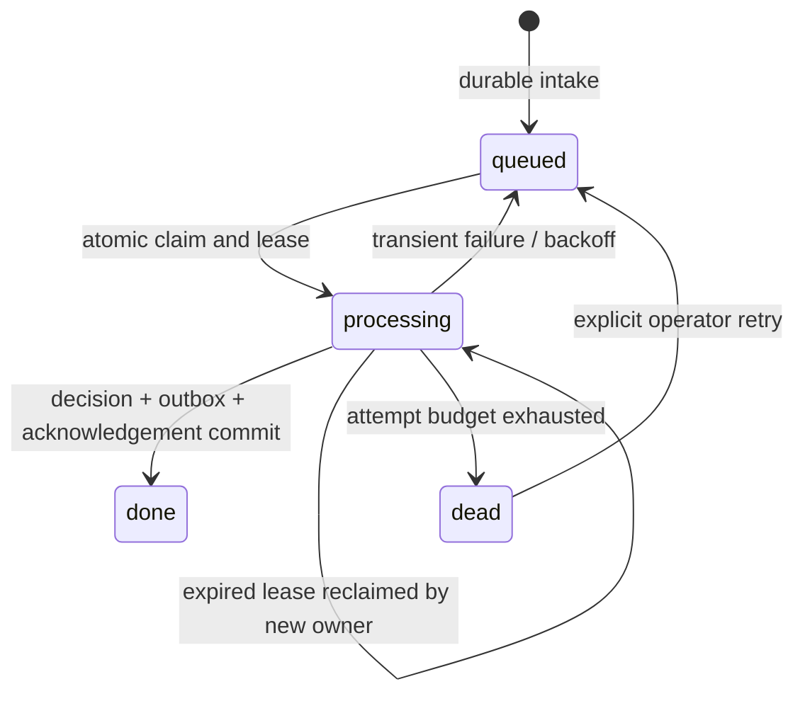

# Architecture and decisions

## Boundaries

The routing engine is a pure function of a normalized order, validated rules and a clock. It returns `routed`, `held` or `ignored`, stable reason codes and zero or more tasks. There are no network calls or database writes in the engine. Any validation failure yields no tasks, including digital tasks in a mixed cart.

The HTTP adapter verifies the exact request bytes before JSON parsing, validates metadata, normalizes an allowlisted subset and commits a durable inbox entry. It returns `202` for accepted work and `200` for a matching duplicate. Neither response means fulfilment has occurred.

The store uses SQLite WAL, full synchronous writes, a busy timeout and `BEGIN IMMEDIATE` transactions. Completed delivery records retain identifiers and a raw-body SHA-256 hash, but remove the normalized payload. Failed/queued records retain that minimal payload for recovery. Raw bodies are never persisted.

## Delivery and snapshot identity

- Delivery key: JSON tuple of shop, topic and `X-Shopify-Webhook-Id`.
- Same key and body hash: duplicate, no new work.
- Same key and different body hash: `409 DELIVERY_PAYLOAD_CONFLICT`, no overwrite.
- `X-Shopify-Event-Id`: optional correlation field, not an ordering clock.
- Order key: shop and order ID. `updated_at` is normalized to UTC ISO format.
- Older order snapshot: mark the delivery stale, keep the current decision.
- Same timestamp and identical normalized content: mark unchanged.
- Same timestamp and different content: hold with `CONFLICTING_ORDER_SNAPSHOT` and supersede all current proposals. A strictly newer snapshot is needed to recover normal routing.
- Newer snapshot: replace the decision and supersede current proposals, including on cancellation, hold or full fulfilment.

Timestamps are not a transactional Shopify version number. Changes within one timestamp or webhook gaps need authoritative reconciliation before any live execution. This service never executes the proposed tasks, so replacement cannot reverse or duplicate an actual shipment.

## Worker state machine

Claims increment attempts and assign a random owner token. A worker can commit only while it owns an unexpired lease. An expired worker cannot acknowledge a newer owner's job. A final-attempt crash is swept into `dead` when its lease expires. Database exceptions roll back the entire decision transaction, then a separate failure update schedules a retry.

The default lease is 30 seconds; retry budget is five attempts, with 1/2/4/8-second delays before the final attempt. The generalized delay is capped at 60 seconds. No long-running network work belongs inside this transaction; external adapters need a separate effect outbox, idempotency keys, their own leases and reconciliation.

## Outbox contract

Each proposed task has a deterministic SHA-256 ID based on shop/order key, normalized snapshot, rules hash and task index. Task payloads contain destination, task type and line quantities. The output does not contain a delivery address or recipient email; an authorized downstream adapter must retrieve only the information it needs.

Tasks are `proposed` or `superseded`. There is no `sent` state because there is no dispatcher. Digital delivery and pickup preparation are explicit work queues, not assertions that those actions happened.

## Shopify API choice

Admin GraphQL is used for the optional reader and proposal contract. REST order IDs are not fulfilment-order IDs. The proposal builder requires FulfillmentOrderLineItem GIDs, open/movable state and quantity limits from the provided snapshot. It fails on truncated pagination, duplicate lines and ambiguous IDs.

The HTTP webhook service uses Shopify's documented manual HMAC algorithm. It does not implement OAuth or session authentication. An installable app should use Shopify's official app libraries for those additional boundaries. No Shopify CLI or live app configuration is required to run this standalone demo.

## Deliberate tradeoffs

- Built-in Node SQLite keeps the demo easy to run and avoids a native database package. The Node 24 runtime is constrained and documented.
- Static stock makes routing deterministic. It cannot prevent overselling across orders.
- Fail-closed SKU and pickup contracts prefer review over a guessed route.
- Service access is one configured shop and one admin token. Multi-tenant installs need tenant-scoped secret/session storage and authorization.
- Read API responses show the most recent 100 orders/deliveries and 200 tasks. They are an operations snapshot, not a full export or paginated analytics API.
- No scheduled cleanup deletes evidence silently. Operators must choose retention and preserve deduplication coverage for their retry/replay horizon.
